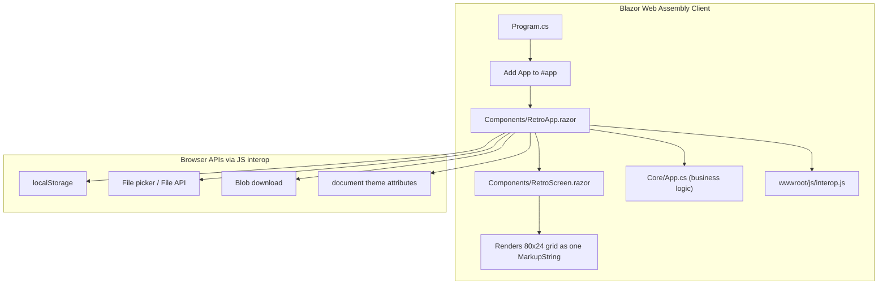
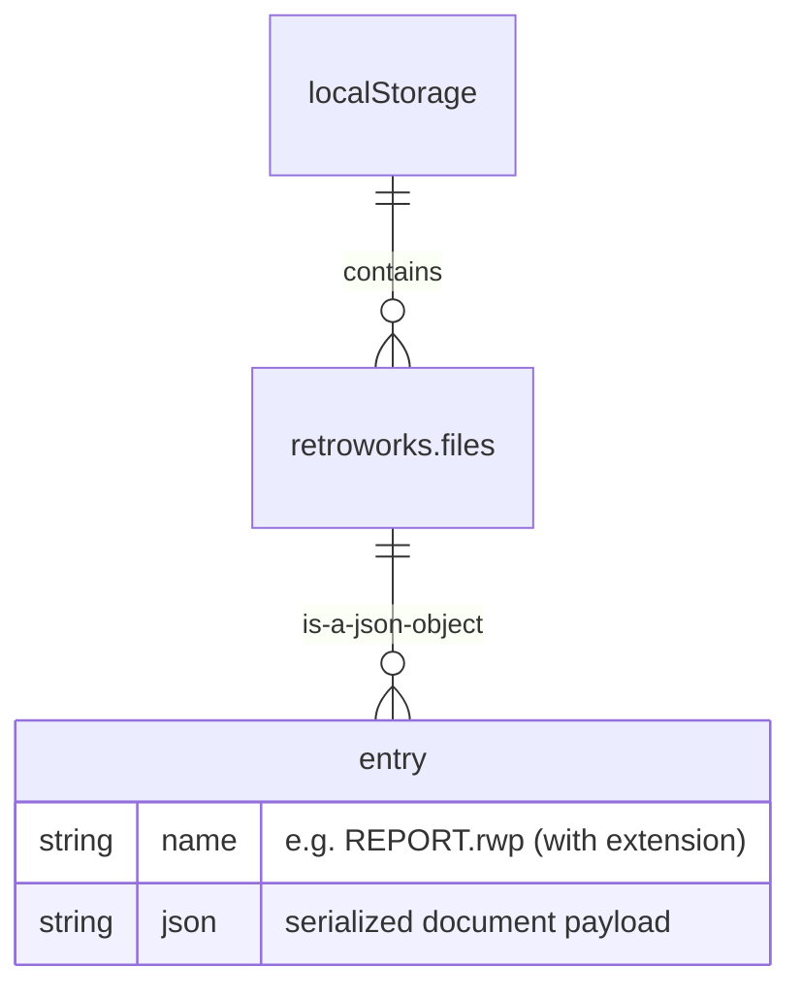
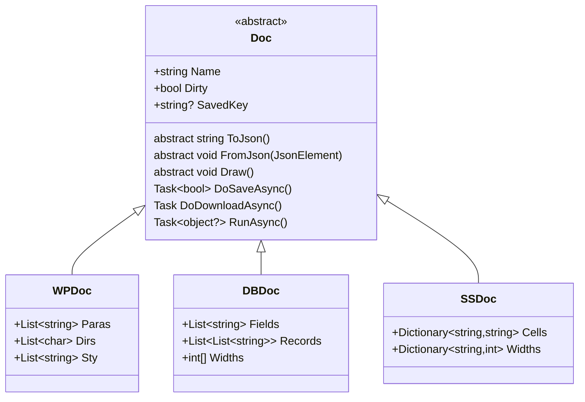
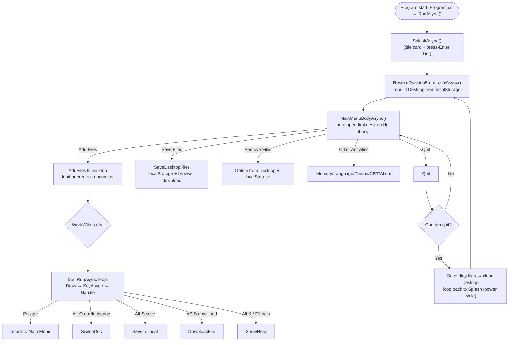
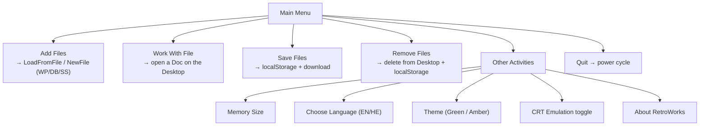

> **Maintenance rule.** This document is a living artifact: it must be updated whenever non‑trivial changes are made to the application (new document type, new persistence mechanism, significant refactor of flows, version bumps, etc.). If you change this code and do not update `Architecture.md`, revert the change.

An integrated **Word Processor (WP)**, **Data Base (DB)** and **Spreadsheet (SS)** in the style of the 80‑column, green‑screen productivity software of the Apple II years, rebuilt for today's web browser. Originally a Python program; ported to Blazor WebAssembly (WASM).

> **Note on provenance.** This project is derived from an original Python implementation (`retroworks.py`). The Python code is treated as read‑only reference material and has been fully ported to the C# / Blazor WASM stack described below. It is intentionally **not** part of this architecture — see [Appendix A: Provenance](#appendix-a-provenance-and-what-this-document-ignores).

---

## Table of Contents

1. [Executive Overview](#executive-overview)
2. [Patterns and Technologies Used](#patterns-and-technologies-used)
3. [Data Model Details / How Files Are Stored](#data-model-details-/how-files-are-stored)
4. [Screen Flows](#screen-flows)
5. [Important Application Entry Points](#important-application-entry-points)
6. [Key Business Rules](#key-business-rules)
7. [Key Architectural Takeaways](#key-architectural-takeaways)
8. [Getting Started for Developers](#getting-started-for-developers)
9. [Glossary](#glossary)
10. [Appendix A — Provenance and What This Document Ignores](#appendix-a-provenance-and-what-this-document-ignores)
11. [Revision History](#revision-history)

---

## Executive Overview

RetroWorks is a single-page desktop application that runs entirely in the browser via **Blazor WebAssembly**. It emulates an Apple II–era "desktop": files live on a virtual **Desktop**, are managed through stacked, folder‑style menus, and persist between sessions using the browser's `localStorage`. There is no backend server, database, or authentication — all state lives client-side.

The application surface is a fixed **80×24 character grid** rendered as one HTML block with a phosphor (green/amber) CRT aesthetic. Three document types share this surface:

| Kind | Name            | Extension | Data shape                                   |
|------|-----------------|-----------|----------------------------------------------|
| `wp` | Word Processor  | `.rwp`    | Paragraphs + per-character style bits        |
| `db` | Data Base       | `.rdb`    | Fields (columns) × Records (rows)            |
| `ss` | Spreadsheet     | `.rss`    | Cells keyed by reference (`A1`, `$B$2`)      |

### Key characteristics

- **Client-only.** No server, no database. Persistence is browser `localStorage`.
- **One grid, three apps.** A single character/attribute buffer is drawn and consumed by whichever document is "current".
- **Event-driven input.** The browser captures keyboard events via JS interop and forwards string tokens to a C# async loop.
- **Portable data model.** Every file serializes to JSON; the same payload can be saved to `localStorage` *or* downloaded as a real file from the browser.

---

## Patterns and Technologies Used

### Technology stack & versions

| Layer            | Technology                                             | Version / Target        |
|------------------|--------------------------------------------------------|-------------------------|
| Runtime          | .NET (Blazor WebAssembly SDK)                          | **.NET 10** (`net10.0`) |
| UI framework     | Microsoft.AspNetCore.Components.WebAssembly            | **10.0.13**             |
| Dev server       | Microsoft.AspNetCore.Components.WebAssembly.DevServer  | 10.0.13                 |
| Localization     | .NET `System.Resources.ResourceManager` (RESX)         | BCL                     |
| Serialization    | `System.Text.Json`                                     | BCL                     |
| Browser interop  | `Microsoft.JSInterop`, `[JSInvokable]`                 | part of Blazor WASM     |
| Front-end        | Plain HTML/CSS (no framework)                          | —                       |
| Font             | VT323 (Google Fonts)                                   | —                       |

> **AOT note.** `RunAOTCompilation=false` is set explicitly. The formula engine and bidi code are CPU‑heavy, so ahead‑of‑time compilation was disabled in favour of JIT performance.

### Architectural patterns

- **Layered / porting-boundary pattern.** Business logic lives in plain C# classes under `Core/`; the Blazor component layer (`Components/`) is a thin interop bridge; browser APIs live in `wwwroot/js` and `wwwroot/css`.
- **Strategy / polymorphism for document types.** An abstract `Doc` base class defines the contract (`ToJson`, `FromJson`, `Draw`, `Size`); each document type implements it.
- **Dependency injection via function slots.** The `App` controller receives its browser hooks (download, file picker, localStorage) as injectable delegate properties set by the component — mirroring DI but without a container.
- **Event-delegation rendering.** `App` raises `RenderRequested`; the component subscribes and calls `StateHasChanged()`.
- **Command / async loop.** All user interaction flows through an async key-dispatch loop rather than imperative event handlers.

### Component & file map





---

## Data Model Details / How Files Are Stored

### Persistence model: `localStorage` as "the disk"

RetroWorks has **no server and no database**. The browser's `localStorage` is the entire persistent store — affectionately referred to in code as *"the disk"* (it survives refresh/restart but is per-browser-profile, not network-shared).

- All files are stored under a single namespaced key: **`retroworks.files`**.
- Each entry maps a file name *with extension* (e.g. `"REPORT.rwp"`) to its JSON payload string.
- The JS layer tolerates a corrupt store (returns `{}` instead of throwing) so the app never crashes on bad data — it simply starts fresh.



### On-disk / download format

Every file serializes to a JSON envelope produced by `Doc.SaveJson()`:

```json
{
  "app": "RetroWorks",
  "version": 1,
  "type": "ss",
  "cells": { "A1": "=SUM(A2:A5)", "B1": "42" },
  "widths": { "A": 10 }
}
```

The same payload is used for **both** persistence and browser download — there is no separate on-disk vs. downloadable format. This means a downloaded file can be re-imported later, and vice-versa.

### Document types (data model)

All three document classes derive from the abstract `Doc` base class (`Core/Doc.cs`). The base defines: name, dirty flag, clipboard slots, save/download/load helpers, and the main run loop. Each subclass implements `ToJson()` / `FromJson()` and holds its own data.



**Word Processor (`WPDoc`)** — `Core/WPDoc.cs`:

- `Paras` (`List<string>`): one entry per paragraph.
- `Dirs` (`List<char>`): per-paragraph base direction, `'L'` or `'R'`.
- `Sty` (`List<string>`): per-character style bits (`'0'` plain, `'1'` bold, `'2'` underline, `'3'` both). Omitted from JSON when all plain.

**Data Base (`DBDoc`)** — `Core/DBDoc.cs`:

- `Fields` (`List<string>`): column headers/categories.
- `Records` (`List<List<string>>`): rows of string values.
- `Widths` (`int[]`): per-column display width.
- Supports single-record vs. multi-record layouts, filter, sort, select.

**Spreadsheet (`SSDoc`)** — `Core/SSDoc.cs`:

- `Cells` (`Dictionary<string,string>`): keyed by cell reference such as `"A1"`, `"$B$2"` (absolute refs preserved).
- `Widths` (`Dictionary<string,int>`): per-column width.
- Implements `FormulaEngine.ISheet` so the formula engine can resolve cell values and ranges.

### Formula engine data model (`Core/FormulaEngine.cs`)

The spreadsheet's calculation engine is a self-contained, pure‑C# tokenizer + recursive-descent parser:

- **Cell references:** columns `A–Z`, rows `1–999`. Relative (`A1`) or absolute (`$A$1`).
- **Tokenizer regex** accepts numbers (with scientific notation), cell refs, functions (`@SUM`, etc.), and operators.
- **~20 built-in functions:** `SUM`, `AVG`/`AVERAGE`, `MIN`, `MAX`, `COUNT`, `ABS`, `INT`, `SQRT`, `EXP`, `LN`, `LOG`, `SIN`, `COS`, `TAN`, `ATAN`, `ROUND`, `MOD`, `IF`.
- **Error handling:** circular references and math errors raise a custom `SSError` exception.
- Reference adjustment (`ShiftRefs`, `FixRows`) keeps relative refs correct when rows/columns are inserted or deleted.

### Memory model (the "memory game")

The Desktop enforces an Apple II–style memory constraint:

```csharp
Avail() => Math.Max(0, MemKb - ProgramK - Desktop.Sum(d => d.Size()) / 1024);
```

- `MemKb` — selectable memory size (default **1024** KB; options: 128/512/1024/3072).
- `ProgramK` — constant overhead of **72** KB.
- Each document reports an approximate byte size via `Size()`, used to cap how many files fit on the Desktop and whether new files can be added (`DesktopFull` / `DesktopMemoryFull`).

---

## Screen Flows

### Application lifecycle (the power-cycle loop)

The entire session is driven by a single recursive loop. **Quit = "power cycle"**: dirty files are saved, then the app clears its Desktop and re-runs from the splash screen — so restarting behaves exactly like a cold boot (saved files come back).



### Main Menu flow

The main menu is a stacked, folder‑style list. Each sub-menu opens on top of the last like a tab; **Escape** steps back one layer. The first desktop file (if any) auto-opens when entering the menu.

| Choice | Action |
|--------|--------|
| 1 | Add files to Desktop — load from file or create WP/DB/SS |
| 2 | Work with a file on the Desktop (or pick one of up to 12 open) |
| 3 | Save all changed files (to `localStorage` **and** download) |
| 4 | Remove files from the Desktop (downloads first if dirty) |
| 5 | Other Activities — memory size, language, theme, CRT emulation, about |
| 6 | Quit (power cycle) |



### Other Activities sub-menu

| Choice | Action |
|--------|--------|
| 1 | Memory Size — change `MemKb`, which re-derives the Desktop limit and "K Avail." counter |
| 2 | Choose Language — switch RESX culture (`en`/`he`) |
| 3 | Theme — toggle phosphor colour (green default / amber) via a CSS `data-theme` attribute |
| 4 | CRT Emulation — toggle scanline/screen-door overlay + rounded glass edges |
| 5 | About RetroWorks — show help text page |

### Document run loop (`Doc.RunAsync`)

Each document renders in the same grid. The loop draws, then awaits a key; special tokens short-circuit:

- **Escape** → return to Main Menu.
- **Alt-Q** (`"A-Q"`) → quick-change to another desktop file.
- **Alt-S** (`"A-S"`) → save to `localStorage`.
- **Alt-Shift-S** (`"AS-S"`) → download the file from the browser.
- **Alt-K / F1** → show help text for that document type.

### Key token model

Keyboard events are mapped by JS (`wwwroot/js/interop.js`) into string tokens consumed by the C# loop:

| Token | Meaning |
|-------|---------|
| `UP`, `DOWN`, `LEFT`, `RIGHT` | Arrow keys (arrows swap L/R in RTL) |
| `HOME`, `END`, `PGUP`, `PGDN` | Editing navigation |
| `BKSP`, `DEL`, `ENTER`, `ESC`, `TAB`, `BTAB`, `F1` | Named keys |
| `A-X` | Alt + letter (e.g. `Alt-Q` → `"A-Q"`) |
| `AS-X` | Alt+Shift + letter — the download variant of an Alt command (`Alt-Shift-S` → `"AS-S"`) |

Any other single printable character passes through unchanged (so formulas like `=A1+B2` work).

---

## Important Application Entry Points

### Code entry points

| Method / File | Location | Responsibility |
|---------------|----------|----------------|
| `RunAsync()` | `Core/App.cs` | Orchestrates the full session: Splash → Restore Desktop → Main Menu loop. This is the top-level driver. |
| `MainMenuBodyAsync()` | `Core/App.cs` | The repeating main-menu loop; quits when confirmed. Auto-opens the first desktop file each iteration. |
| `RestoreDesktopFromLocalAsync()` | `Core/App.cs` | Rebuilds the Desktop from `localStorage`; skips corrupt/oversized entries without crashing. |
| `WorkAsync(Doc)` | `Core/App.cs` | Runs a document's loop; follows "Escape → MENU → Alt-Q → next doc" chains. |
| `Doc.RunAsync()` | `Core/Doc.cs` | Per-document draw/key/handle loop. |

### UI entry points (Blazor)

| Component / Hook | Location | Responsibility |
|------------------|----------|----------------|
| `OnAfterRenderAsync(firstRender)` | `Components/RetroApp.razor` | Imports the JS module, wires interop functions, registers the global keydown handler, and launches `_app.RunAsync()` on a background task. Runs once at startup. |
| `[JSInvokable] OnKey(string token)` | `Components/RetroApp.razor` | Receives tokens from JS; enqueues them into `Core.App`. Must live on the component (not `Core.App`) because JS can only invoke methods on a `DotNetObjectReference` target. |
| `RenderRequested` event → `_tick`/`StateHasChanged()` | `Components/RetroApp.razor` | Translates each draw into a Blazor re-render of the grid. |

### Browser interop entry points (`wwwroot/js/interop.js`)

| Function | Purpose |
|----------|---------|
| `initKeyHandler(ref)` | Installs the global keydown listener; fits the grid font to the viewport. |
| `mapKey(e)` | Maps a `KeyboardEvent` → RetroWorks token (or `null`). |
| `downloadFile(fileName, content)` | Triggers a browser download via Blob/Object URL. |
| `loadFile(accept)` | Opens the file picker; resolves with text or `null` on cancel/timeout. |
| `saveLocalFile(name, json)` / `loadLocalFile(name)` / `listLocalFiles()` / `deleteLocalFile(name)` | CRUD over the `retroworks.files` localStorage namespace. |
| `setTheme(theme, crt)` | Applies phosphor theme + CRT emulation to `<html>`. |
| `reportError(msg)` | Surfaces an app-loop exception in a red banner at the bottom of the screen. |

---

## Key Business Rules

1. **Save vs. download are distinct operations.** `DoSaveAsync()` writes only to `localStorage`; `DoDownloadAsync()` triggers a browser download. The main-menu "Save Files" does **both** so the on-disk copy stays in sync with what you can download.
2. **Rename cleanup.** Every document tracks its last storage key (`SavedKey`). On rename+save, the stale entry is deleted so it cannot resurface as a ghost file or be silently overwritten. Removing a desktop file also deletes its `localStorage` entry.
3. **Quit = power cycle.** Quitting saves dirty files and restarts from the splash screen; saved files are restored automatically — the app never "loses" state across a quit.
4. **Dirty flag gates persistence.** A failed save keeps the document marked dirty; only successful writes clear it. Removing a dirty file first downloads a copy before deleting (the storage entry is gone).
5. **Memory constraint governs Desktop capacity.** `Avail()` caps how many files fit and whether new ones can be added (`MaxDesktop = 12`). File sizes are approximate byte estimates, not exact.
6. **Corruption tolerance.** Corrupt `localStorage` entries, oversized files, or interop-not-ready states are skipped (not fatal). The app starts with an empty Desktop rather than crashing.
7. **Any printable char edits in SS/DB.** Starting to type in a spreadsheet/database cell accepts any non-control character — never filtered to letters/digits — so formula entry (`=`, `(`, `-`, `/`, `.`, `,`, `"`) works.
8. **Formula safety.** The engine raises `SSError` for circular references and syntax/math errors; the cache is cleared on every edit. Absolute vs. relative references are preserved through row/column edits.
9. **Menu digit selection guard.** Over-long numeric input is sliced to the last two digits before parsing, preventing index-overflow crashes (e.g. slicing a 1-char string with `[^2..]` would throw).
10. **Localization is mandatory for both languages.** Every new user-facing string must exist in both `Strings.resx` (EN) and `Strings.he.resx` (HE); Hebrew text is laid out via the Unicode bidi algorithm (`Bidi.BidiVisual`).

---

## Key Architectural Takeaways

- **No infrastructure, no auth, no server.** The entire system is a client-side Blazor WASM app. "Persistence" is browser `localStorage`; there are no accounts, tokens, or roles — hence no authentication layer (see [Appendix A](#appendix-a-provenance-and-what-this-document-ignores)).
- **One grid, three apps.** A single character/attribute buffer (`char[,] VChars`, `int[,] VAttrs`) is the shared rendering surface for WP/DB/SS. This keeps memory and layout simple but means document switching is a full redraw of the same 80×24 canvas.
- **Thin Blazor shell, fat C# core.** The `.razor` components are deliberately thin: they own JS interop and translation (via `DotNetObjectReference`) but delegate all behaviour to plain C# classes in `Core/`. This makes the port testable without a browser.
- **Interop is the seam.** All browser APIs — input, file picker, download, localStorage, theme — cross the WASM boundary as injected function slots on `App`, keeping the core free of DOM concerns.
- **Resilience by design.** Every external boundary (localStorage read/write, file load, interop) is wrapped to degrade gracefully rather than crash the app loop — critical because a thrown exception in the async loop would freeze the UI.
- **Portable data format.** JSON envelopes are simultaneously the persistence payload and the downloadable/importable file format, giving free round-trip portability between sessions and devices (browser-independent).
- **Cultural display, not just translation.** Beyond string substitution, the app performs real bidirectional text layout (`Bidi`) so Hebrew/Arabic content renders correctly regardless of base direction.

---

## Getting Started for Developers

### Prerequisites

- **.NET 10 SDK** (the project targets `net10.0`). Install the .NET 10 developer pack if it is not already present:

  ```powershell
  dotnet --install-tool
  # or install the .NET 10 SDK from https://dot.net
  ```

- A modern web browser (Chrome, Edge, Firefox) for running and verifying the UI.

### Build

```powershell
dotnet build "c:\dev\RetroWorks\conversion\RetroWorks\RetroWorks.csproj" --nologo -v q
```

Standard is **0 warnings, 0 errors**. Never leave a build with warnings.

### Run (development)

```powershell
dotnet run --project "c:\dev\RetroWorks\conversion\RetroWorks\RetroWorks.csproj"
# → http://localhost:5114  (from Properties/launchSettings.json)
```

The dev server (`Microsoft.AspNetCore.Components.WebAssembly.DevServer`) serves the WASM bundle and hot-reloads C#. Open the URL in a browser; the app boots through Splash → Desktop restore → Main Menu.

> **Dev-server caching.** After a rebuild, existing tabs keep the old in-memory runtime and may hit stale-fingerprint 404s (e.g. `RetroWorks.styles.css`). Hard-reload with a cache-busting query param (`/?t=Date.now()`) or open a fresh tab to see real content.

### Run (published)

Publish to a static folder, then serve it over HTTPS (WASM requires a secure context for some browser APIs):

```powershell
dotnet publish "c:\dev\RetroWorks\conversion\RetroWorks\RetroWorks.csproj" -c Release -o ./publish-output
# Serve the contents of ./publish-output with any static web server.
```

The project also ships a `RetroWorks.bat` / `RetroWorks.command` launcher and can be tried at https://appleworks.auri.net.

### Debugging

- **Breakpoints** work in the C# core (`Core/*.cs`) under the normal debugger; set them and run with `dotnet run --launchProfile http`.
- **Blazor debugging.** The dev server exposes the WASM browser debug proxy (`_framework/debug/ws-proxy?browser=…`). Attach to the process or use the browser DevTools "inspect" link from `launchSettings.json` for component-level inspection.
- **JS interop debugging.** Break on `[JSInvokable] OnKey(string token)` in `Components/RetroApp.razor`; the token string identifies the originating key event. Use the browser console to inspect `interop.js` calls (`saveLocalFile`, `loadFile`, `downloadFile`).
- **App-loop errors** are surfaced in two places: a red banner at the bottom of the grid (via JS `reportError`) and the WASM console output (`Debug.WriteLine("App error: …")`).

### Verifying UI changes without screenshots

Extract the text grid from the rendered DOM — rows are `.retro-row` divs containing `.retro-cell` spans:

```js
Array.from(el.querySelectorAll('.retro-row'))
  .map(row => Array.from(row.children).map(c => c.textContent).join(''))
  .join('\n');
```

Drive the app with `page.keyboard.press` / `page.keyboard.type`; keyboard tokens map 1:1 to physical keys (e.g. type a menu digit, then press Enter — two steps).

---

## Glossary

| Term | Meaning |
|------|---------|
| **Desktop** | The virtual set of open files shown on the home screen; up to 12, bounded by available memory. |
| **Doc** | Abstract base class for all document types (WP/DB/SS). |
| **Dirty** | A document with unsaved changes (shown with a `*` in its title). |
| **SavedKey** | The last `localStorage` key a document was persisted under; used to clean up stale entries on rename. |
| **Avail()** | Available memory = `MemKb − ProgramK − Σ file sizes`; gates adding files and caps the Desktop. |
| **MemKb / ProgramK** | Selectable RAM size (KB) and fixed program overhead (72 KB). |
| **localStorage** | Browser key‑value store used as RetroWorks' entire persistent "disk". |
| **`retroworks.files`** | The single namespaced `localStorage` key holding all saved files. |
| **Token** | A string key (`UP`, `"A-Q"`, `"AS-S"…) representing a keyboard event after JS mapping. |
| **MarkupString rendering** | The grid is rendered as one interpolated HTML string, not per‑cell DOM nodes. |
| **`[JSInvokable]`** | Attribute marking a method callable from WebAssembly JS via `DotNetObjectReference`. |
| **WP / DB / SS** | Word Processor / Data Base / Spreadsheet — the three document kinds. |
| **Formula engine** | Pure‑C# tokenizer + recursive-descent parser for spreadsheet formulas/functions. |
| **Bidi** | Bidirectional text layout support (Hebrew/Arabic) implementing UAX #9. |
| **CRT emulation** | Optional CSS overlay (scanlines, screen-door, rounded glass) toggled from Other Activities. |

---

## Appendix A — Provenance and What This Document Ignores

RetroWorks began as a Python curses application (`retroworks.py`). It has been fully ported to the .NET / Blazor WASM stack described above. Per project convention, **`retroworks.py` is treated as read‑only reference material** — it documents behaviour but is not compiled into or executed by this build and is intentionally out of scope for this architecture document.

Consequently, several areas that a typical ASP.NET/.NET architecture doc would cover are **not applicable here** and are omitted:

- **No database layer.** There is no Entity Framework Core, ADO.NET, SQL Server, or other data-access tier. Documents persist as JSON in `localStorage`.
- **No authentication/authorization.** No identity provider, tokens, roles, or access control — the app is a single anonymous client session. (This is why there is no "Authentication Details" section and no authenticated/guest flow diagram.)
- **No CI/CD, deployment pipeline, or scheduled tasks.** The application runs as a self-contained WASM bundle served by the Blazor dev server / static hosting; nothing runs on a schedule.
- **No message queueing, background services, or timers** beyond the in-process async loops described above.

---

## Revision History

| Version | Date       | Author        | Summary of Changes                                             |
|---------|------------|---------------|----------------------------------------------------------------|
| 1.0     | 2026-10-27 | Copilot SDK   | Initial architecture document for the Blazor WASM port.        |
| 1.1     | 2026-10-27 | Copilot SDK   | Restored the Component & File Map diagram (lost in earlier edits) and hardened all mermaid diagrams against parse errors (removed HTML entities, unquoted parenthesized subgraph titles, and pipe-delimited edge labels). Now exactly 5 clean diagrams. |

> **Maintenance rule.** This document is a living artifact: it must be updated whenever non‑trivial changes are made to the application (new document type, new persistence mechanism, significant refactor of flows, version bumps, etc.). If you change this code and do not update `Architecture.md`, revert the change.