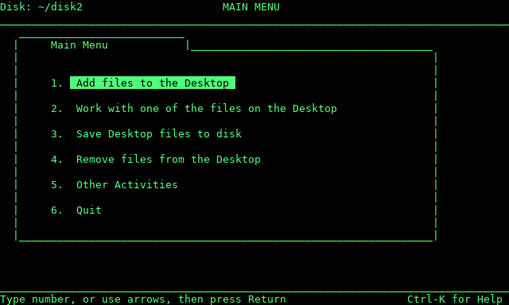
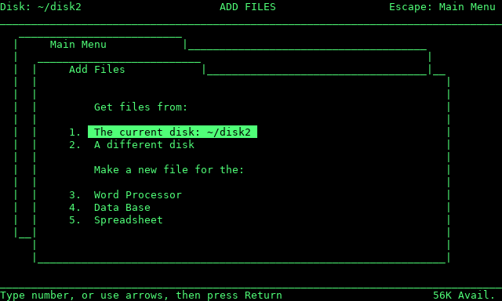
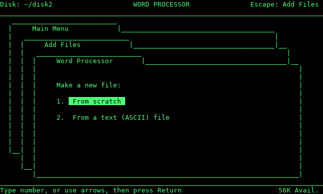

# RetroWorks II

An integrated **Word Processor, Data Base and Spreadsheet** in the style of the
80‑column, green‑screen productivity software of the Apple II years, rebuilt
for today's web browser.

Originally a Python program, and ported to Blazor WASM.

Original Python: https://github.com/udiweinstein/RetroWorks

Blazor WASM ported with Local AI / Qwen 3.8 from the original Python.

## Architecture

Full architecture documentation — data model, screen flows, entry points, and business rules — is in [Architecture.md](./Architecture.md).

## Features

- **Desktop & stacked menus.** Up to 12 open files. Each sub-menu opens on top of
  the last like a folder tab, and Escape steps back one layer. Alt-Q
  (Quick Change) jumps straight to another file.
- **Word Processor.** Word wrap, insert/overwrite, **bold** (Alt-B) and
  underline (Alt-U), find & replace, cut/copy/paste paragraphs, "print" to a
  .txt file, import a text file. Spell check with Alt-W.
- **Spreadsheet.** Formulas like `+A1*B1` and `@SUM(A1...A10)`, about 20
  functions (`@AVG @MIN @MAX @ROUND @IF @SQRT`…), relative and absolute (`$A$1`)
  references, replicate, insert/delete rows, CSV import and export.
- **Data Base.** Multiple-record and single-record layouts (Alt-Z), select,
  sort, edit categories, CSV import and export.
- **Languages.** English and Hebrew (עברית) built in. Choose one under
  *Other Activities → Choose language*; the choice is remembered.
- **Right-to-left text.** In the word processor, Alt-L switches the current
  paragraph between left-to-right and right-to-left. RetroWorks arranges
  Hebrew itself with the Unicode bidirectional algorithm, so punctuation,
  numbers and English words inside Hebrew land in the right place.
  *Other Activities → Right-to-left display* says who reorders the letters:
  macOS Terminal does part of it by itself, Windows Terminal and iTerm2 do
  not. The right choice is picked automatically; the screen shows a sample
  line to check it. Niqqud (vowel points) is not supported.
- **Memory size.** Under *Other Activities → Memory size* pick an
  Apple //e with 128K or a RamWorks III card with 512K, 1 MB or 3 MB. The
  "K Avail." counter and the Desktop limit follow your choice.
- **Browser Filesystem.** All files stored in local storage, persisted between sessions. Download when you like.

### Adding a language

Uses standard .NET Resource / RESX files.

## Running it

Runs as a Blazor WASM site. You can also try it at https://appleworks.auri.net.

## About

Original Python:

Written with Claude (Anthropic's AI). RetroWorks is an independent program
written from scratch. It is **not AppleWorks**, contains no Apple code, and is
not affiliated with or endorsed by Apple Inc.

Blazor WASM:

Same deal, but using llama.cpp and Qwen 3.8. Probably others by the time you read this.

